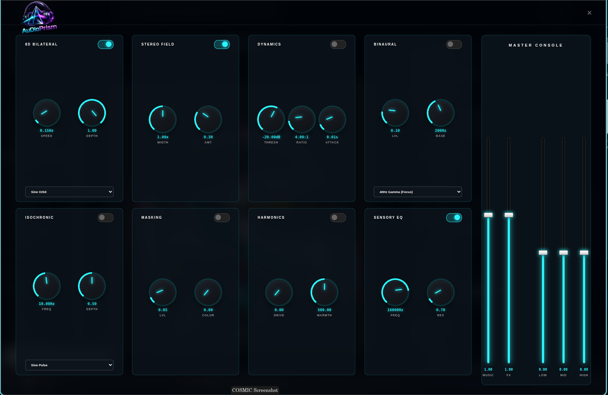

# AuDioPrism

**AuDioPrism** (or simply **Prism**) is a free, open-source Chrome extension that turns YouTube Music into a neurodivergent-friendly listening space. 8D spatial audio, binaural beats, isochronic tones, masking noise, and sensory EQ — built for ADHD, autism, AuDHD, and anyone whose nervous system needs the mix to cooperate.

It is GPL-3.0. No subscription. If someone is charging monthly for this class of tool, they can. We would rather ship it to the community.

> "Bad audio is a hate crime." — Every module is tuned for quality first, then for regulation.

---

## Screenshots




## Features

### 8D Spatial Audio Engine

The core of Prism is a click-free 8D spatializer: equal-power level difference, interaural time difference (~0.66 ms), and contralateral head-shadow filtering. That combination still reads as motion around the head without the zipper noise Chrome's HRTF kernels add when the source moves.

**Movement Patterns:**

| Pattern | Description | Best For |
|---------|-------------|----------|
| **Sine Orbit** | Classic circular movement around your head with subtle elevation changes | General listening, the signature "8D" experience |
| **Ping-pong** | Hard L/R jumps | Bilateral snaps, high stimulation |
| **Figure 8** | Lemniscate that crosses in front of you twice per cycle | Bilateral stimulation, EMDR-like benefits |
| **Pendulum** | Hangs at each ear, then swings | Slow rocking |
| **Tumble** | Corkscrew: L/R and elevation are 90° apart, so the image rolls *over* your head at each center crossing | Deep immersion |
| **Breathe** | Almost no L/R — the source moves closer (louder, brighter) and farther (quieter, darker) | Calm regulation, less seasick |
| **Drift** | Irregular wander from value noise, not a stacked-sine orbit | Ambient listening, reduced predictability |

**Controls:**
- **Speed** (0.01 - 5 Hz): How fast the sound moves around you
- **Depth** (0 - 1): How far from center the sound travels

### Binaural Beats

Binaural beats work by playing slightly different frequencies in each ear. Your brain perceives a "third tone" at the difference frequency, which can encourage brainwave entrainment.

**How It Works:**
- Left ear receives a carrier tone (e.g., 200 Hz)
- Right ear receives carrier + beat frequency (e.g., 210 Hz)
- Your brain perceives a 10 Hz "beat" (Alpha waves)

**Brainwave Frequencies:**

| Frequency | State | Effect |
|-----------|-------|--------|
| **40 Hz** (Gamma) | High cognition | Focus, memory, problem-solving |
| **14 Hz** (Beta) | Active thinking | Concentration, alertness |
| **10 Hz** (Alpha) | Relaxed focus | Calm attention, creativity |
| **6 Hz** (Theta) | Deep relaxation | Meditation, introspection |

**Technical Implementation:**
- Carrier frequency: 200 Hz (research-optimal for perception)
- Pure sine waves for clean beat perception
- Mixed at -22 dB below music (non-destructive)
- Requires headphones for the effect to work

### Isochronic Tones

Isochronic tones are rhythmic pulses of sound that turn on and off at precise intervals. Unlike binaural beats, they don't require headphones and produce stronger cortical responses in many people.

**How It Works:**
- A carrier tone (220 Hz) pulses on and off
- The pulse rate matches your target brainwave frequency
- Sharp transitions create stronger entrainment

**Controls:**
- **Frequency** (1 - 20 Hz): Pulse rate targeting specific brainwaves
- **Depth** (0 - 1): How complete the silence between pulses is
- **Waveform**: Sine (gentler) or Square (sharper entrainment)

**Technical Implementation:**
- Proper AM synthesis with DC offset for clean 0-to-1 pulses
- Mixed at -18 dB below music
- Works through speakers (no headphones required)

### Masking Noise Generator

Background noise can help mask distracting environmental sounds and provide a consistent auditory backdrop for focus.

**Noise Colors:**
- **Brown** (0): Deep, rumbling — like thunder or a waterfall
- **Pink** (0.5): Balanced — like steady rain
- **White** (1): Bright, hissy — like radio static

The Color knob smoothly sweeps between these by adjusting a lowpass filter from 80 Hz to 20 kHz.

### Stereo Field Processing

Adjust the stereo width of your music using Mid-Side processing.

- **Width** (0 - 2x): 0 = mono, 1 = normal, 2 = extra wide
- **Amount**: Cross-feed intensity for the width effect

### Dynamics Processing

**Compressor ("Dynamic Shield"):**
Protects your ears from sudden loud moments by automatically reducing volume spikes.

- **Threshold**: Level where compression begins (-50 to 0 dB)
- **Ratio**: How much to reduce signals above threshold (1:1 to 20:1)
- **Attack**: How quickly compression responds (0 - 100 ms)

### Harmonics (Saturation)

Adds subtle harmonic distortion for warmth and presence.

- **Drive**: Amount of saturation (0 - 100%)
- **Warmth**: Lowpass filter to tame harsh harmonics (dark to bright)

### Sensory EQ

A sweepable lowpass filter for sensory regulation. Useful for reducing harsh high frequencies that can cause discomfort.

- **Frequency** (200 Hz - 20 kHz): Filter cutoff point
- **Resonance** (0 - 10): Emphasis at the cutoff frequency

### Master Console

- **Music Volume**: Main music level (0 - 150%)
- **FX Volume**: Binaural/Isochronic/Noise level (0 - 150%)
- **3-Band EQ**: Low shelf (250 Hz), Mid peak (1 kHz), High shelf (4 kHz)

---

## The Science: Neurodivergent-Friendly Audio

### Why 8D Audio Helps

For people with ADHD, autism, or sensory processing differences:

1. **Reduced Ear Fatigue**: Static stereo can become fatiguing. Movement keeps the listening experience fresh.
2. **Increased Engagement**: The spatial movement provides subtle stimulation that can help maintain focus.
3. **Bilateral Stimulation**: The Figure-8 pattern mimics bilateral stimulation used in EMDR therapy.

### Why Binaural Beats Help

Research suggests binaural beats may:
- Reduce anxiety (Alpha/Theta frequencies)
- Improve focus and attention (Beta/Gamma frequencies)
- Support meditation practices (Theta frequencies)

*Note: Effects vary between individuals. Binaural beats are a tool, not a treatment.*

### Why Isochronic Tones Help

For neurodivergent users, isochronic tones can:
- Provide external rhythmic scaffolding for the brain
- Help maintain task engagement through steady sensory input
- Work without headphones (important for sensory sensitivities)

### Non-Destructive Mixing Philosophy

All supplementary audio (binaural, isochronic, noise) is mixed **beneath** the music at carefully calibrated levels:

| Source | Level | Reason |
|--------|-------|--------|
| Binaural Beats | -22 dB | Subliminal but effective |
| Isochronic Tones | -18 dB | Audible pulse, not overpowering |
| Masking Noise | -26 dB | Background texture only |

This ensures the music remains the primary experience while the therapeutic tones work subtly alongside it.

---

## Installation

This extension is built for **Google Chrome** (Manifest V3). This repository *is* the unpacked extension — `manifest.json` is at the repo root.

1. Clone this repository (or download the ZIP and unpack it).
2. Open Chrome and go to `chrome://extensions/`.
3. Enable **Developer mode**.
4. Click **Load unpacked**.
5. Select **this folder** — the one that contains `manifest.json`.

If the mixer UI looks old after a reload, refresh the YouTube Music tab so the content script actually updates.

## How to Use

1. Open [music.youtube.com](https://music.youtube.com) and start playing a track.
2. Click the **AuDioPrism icon** in the Chrome toolbar.
3. Click **Open mixer**.
4. A glass launcher appears on the page. **Click** it to start the engine / open the mixer. **Drag** it anywhere — the position is remembered.
5. Close the mixer (X, Esc, or the dimmed edge) to get YouTube Music back — processing keeps running. Stop the engine from the power button or the popup.
6. **Use headphones** for binaural beats and optimal 8D.

The now-playing bar has **previous / play-pause / next**, real track time, and a seek bar. Those drive YouTube Music's player, so the queue, scrobble, and media keys stay in sync. **?** opens the shortcut list. With the mixer open:

| Key | Action |
|-----|--------|
| **Space** | Play / pause |
| **[** | Previous track |
| **]** | Next track |
| **A** (hold) | Dry compare |
| **S** | Beat-sync 8D |
| **1–5** | Presets |
| **Esc** | Close mixer (engine keeps running) |

### Quick Start Recommendations

**For Focus (ADHD):**
- 8D: Sine Orbit, Speed 0.15 Hz, Depth 0.8
- Binaural: 40 Hz Gamma or 14 Hz Beta
- Dynamics: ON (Threshold -20 dB)

**For Relaxation:**
- 8D: Drift, Speed 0.08 Hz, Depth 0.6
- Binaural: 10 Hz Alpha or 6 Hz Theta
- Masking: Brown noise at low level

**For Sensory Overload:**
- Sensory EQ: Reduce Freq to 8-12 kHz
- Dynamics: ON (aggressive settings)
- 8D: OFF or very slow

---

## Technical Architecture

### Audio Signal Flow

```
YouTube Music Audio
        │
        ▼
   [Music Gain] ──► [Stereo Widener] ──► [3-Band EQ]
        │                                      │
        │                                      ▼
        │                              [Sensory Filter]
        │                                      │
        │                                      ▼
        │                              [Saturation]
        │                                      │
        │                                      ▼
        │                              [Compressor]
        │                                      │
        │                                      ▼
        │                              [8D Spatial Panner]
        │                                      │
        ▼                                      ▼
   [FX Gain] ◄── Binaural ──────────────► [Master Gain]
        │       Isochronic                     │
        │       Noise                          ▼
        │                                 [Limiter]
        │                                      │
        └──────────────────────────────────────┘
                                               │
                                               ▼
                                          [Output]
```

### Key Technologies

- **Web Audio API**: All processing uses native browser audio nodes
- **Smooth 8D**: Equal-power ILD + ITD + head-shadow, scheduled on the audio clock
- **Offscreen Document**: Audio processing runs in isolated context for stability
- **Shadow DOM**: UI is encapsulated to avoid conflicts with YouTube Music

### Permissions

| Permission | Purpose |
|------------|---------|
| `tabCapture` | Capture audio from YouTube Music tab |
| `offscreen` | Run audio engine in background document |
| `scripting` | Inject control panel UI |
| `music.youtube.com` | Restrict to YouTube Music only |

---

## Project Structure

```
├── manifest.json        # MV3 extension config (load this folder)
├── defaults.js          # Shared boot patch (mixer + engine)
├── background.js        # Service worker / capture lifecycle
├── offscreen.html       # Audio engine document
├── audio-engine.js      # DSP: 8D, binaural, isochronic, etc.
├── spatial-motion.js    # 8D path math (tumble / breathe / drift)
├── content.js           # Mixer UI (Shadow DOM)
├── popup.html/.js       # Toolbar popup
├── icons/
└── screenshots/
```

---

## References & Research

- [MDN Web Audio API Spatialization](https://developer.mozilla.org/en-US/docs/Web/API/Web_Audio_API/Web_audio_spatialization_basics)
- [Oster, G. (1973). Auditory beats in the brain. Scientific American](https://www.scientificamerican.com/article/auditory-beats-in-the-brain/)
- [PMC: Effects of Binaural Beat Stimulation on Cognitive Functioning](https://pmc.ncbi.nlm.nih.gov/articles/PMC7204407/)
- [Audioengine: ADHD and Binaural/Isochronic Comparison](https://audioengine.com/explore/adhd-and-music-how-binaural-beats-and-isochronic-tones-compare-for-better-focus/)
- [Google Omnitone: Spatial Audio Rendering](https://github.com/GoogleChrome/omnitone)

---

## License

This project is licensed under the **GNU General Public License v3.0** - see the [LICENSE](LICENSE) file for details.

You are free to use, modify, and distribute this software under the terms of the GPL-3.0. If you distribute modified versions, they must also be open-sourced under GPL-3.0.

---

*Built with care for neurodivergent listeners.*
