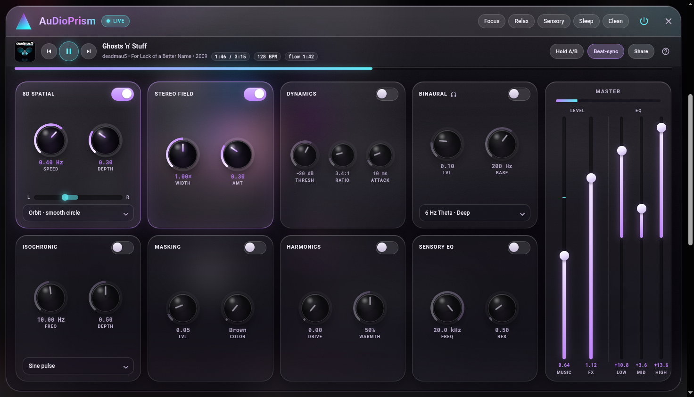
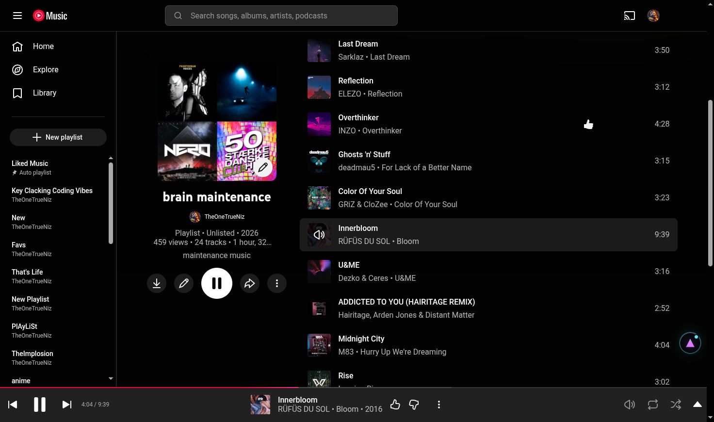

# AuDioPrism

**AuDioPrism** (or simply **Prism**) is a free, open-source Chrome extension that turns a music tab into a neurodivergent-friendly listening space. Click-free 8D spatial audio, binaural beats, isochronic tones, masking noise, and sensory EQ — built for ADHD, autism, AuDHD, and anyone whose nervous system needs the mix to cooperate.

It is GPL-3.0. No subscription. Headphones recommended.

Works in Chrome on the **web players**:

- [YouTube Music](https://music.youtube.com)
- [Spotify Web](https://open.spotify.com)
- [Apple Music Web](https://music.apple.com)

Desktop apps, phone apps, and Spotify Connect devices in another room are out of scope. Playback has to be happening **in that Chrome tab**.

> "Bad audio is a hate crime." — Every module is tuned for quality first, then for regulation.

---

## Screenshots




---

## What you get

A glass mixer that sits on YouTube Music without replacing the player.

- **8D spatial** — stereo-preserving motion (ILD + ~0.66 ms ITD + far-ear head-shadow). No HRTF hops, so it does not zipper when the image moves.
- **Seven paths** that actually differ: Orbit, Ping-pong, Figure-8, Pendulum, Tumble (rolls over the head), Breathe (near/far, almost no L/R), Drift (irregular wander).
- **Beat-sync** locks 8D motion to the song tempo when a BPM is detected.
- **Hold A/B** to hear the unprocessed track.
- **Now-playing bar** with prev / play-pause / next, real track time, click-to-seek, BPM, and a flow timer. Those clicks hit YouTube Music’s own player, so the queue stays honest.
- **Draggable launcher** on the page. Click opens the mixer. Drag parks it. Position is remembered.
- **Presets:** Focus, Relax, Sensory, Sleep, Clean.
- **Closing the mixer does not stop the engine.** Power button or the popup Stop does.

Boot is music-first: 8D Orbit on, width on, dynamics on, sensory filter at 12 kHz, extra tones off.

---

## Installation

Chrome, Manifest V3. This repository **is** the unpacked extension — `manifest.json` is at the repo root.

1. Clone this repository (or download the ZIP and unpack it).
2. Open `chrome://extensions/`.
3. Enable **Developer mode**.
4. Click **Load unpacked**.
5. Select **this folder** — the one that contains `manifest.json`.

Open YouTube Music, Spotify Web, or Apple Music Web, play a track, then **Open mixer** from the toolbar popup.

If the mixer looks like an old build after you reload the extension, refresh the music tab so the content script updates.

---

## How to use

1. Start a track in a supported web player tab.
2. Click the AuDioPrism icon in the toolbar → **Open mixer**.
3. A glass launcher appears on the page. **Click** it to start processing. **Drag** it out of the way if it covers a row.
4. Close the mixer with **X**, **Esc**, or the dimmed edge. Audio keeps running.
5. Stop processing from the power button or **Stop engine** in the popup.

Headphones for binaural beats and the full 8D image. Isochronic tones and masking still work on speakers.

### Shortcuts (mixer open)

| Key | Action |
|-----|--------|
| **Space** | Play / pause |
| **[** **]** | Previous / next track |
| **A** (hold) | Dry compare |
| **S** | Beat-sync 8D |
| **1–5** | Focus, Relax, Sensory, Sleep, Clean |
| **?** | Shortcut list |
| **Esc** | Close mixer (engine keeps running) |

### Presets

| Chip | Intent |
|------|--------|
| **Focus** | Faster orbit, gamma binaural, dynamics on |
| **Relax** | Slow Drift, alpha, a little brown noise |
| **Sensory** | 8D off, darker highs, compression, masking |
| **Sleep** | Slow Drift, theta, darker filter |
| **Clean** | Everything off — dry YouTube Music through the engine |

---

## Mixer

### 8D Spatial

Equal-power level difference, interaural time, and contralateral high-shelf. Distance also changes level, so Breathe is a real near/far pump, not a brightness wobble.

| Pattern | What it does |
|---------|----------------|
| **Orbit** | Smooth circle, the classic 8D path |
| **Ping-pong** | Hard L/R |
| **Figure-8** | Crosses in front of you twice per cycle |
| **Pendulum** | Hangs at each ear, then swings |
| **Tumble** | L/R and elevation 90° apart — rolls *over* the head at center |
| **Breathe** | Almost no pan. Near = louder/brighter, far = quieter/darker |
| **Drift** | Value-noise wander, not a stacked-sine orbit |

**Speed** 0.02–2 Hz. **Depth** 0–1. Beat-sync scales that motion to the detected tempo.

### Stereo field

Mid-side width (0 = mono, 1 = natural, 2 = extra wide) plus cross-feed amount.

### Dynamics

Compressor for sudden spikes. Threshold −50 to 0 dB, ratio 1:1 to 20:1, attack 0–100 ms.

### Binaural

Different sine tones in each ear. Headphones required. Mixed under the music.

| Beat | Band | Typical use |
|------|------|-------------|
| 40 Hz | Gamma | Focus |
| 14 Hz | Beta | Alert |
| 10 Hz | Alpha | Relax |
| 6 Hz | Theta | Deep / sleep |

### Isochronic

A pulsing carrier. Headphones not required. Sine (gentler) or square (sharper).

### Masking

Brown → pink → white via the Color knob (lowpass 80 Hz–20 kHz).

### Harmonics

Soft saturation. Drive and warmth.

### Sensory EQ

Sweepable lowpass for harsh highs. Frequency 200 Hz–20 kHz, resonance 0.1–8.

### Master

Music / FX faders (0–150%) and a 3-band EQ (low shelf, mid peak, high shelf).

FX (binaural, isochronic, noise) sit **under** the music and do **not** go through 8D.

---

## Why this shape of mix

Static stereo can fatigue. Slow spatial motion is a gentle form of novelty. Figure-8 is bilateral. Breathe is for people who want regulation without the image flying around their head.

Binaural and isochronic tones are **tools, not treatment**. Effects vary. If a setting makes you worse, turn it off — Clean is one click.

---

## Architecture

```
YouTube Music tab
        │  tabCapture
        ▼
Offscreen AudioContext (playback latency)
        │
        ├─ music ─► widener ─► EQ ─► sensory ─► sat ─► compressor ─► 8D ─► master
        │                                                                  │
        └─ FX (binaural / iso / noise) ────────────────────────────────────┤
                                                                           ▼
                                                              limiter → output
```

A/B dry is a short equal-power bypass of the processed path, not a graph teardown.

UI is a Shadow DOM overlay. The engine lives in an offscreen document so closing the mixer does not recapture or click.

### Permissions

| Permission | Why |
|------------|-----|
| `tabCapture` | Hear the YouTube Music tab |
| `offscreen` | Keep the engine alive with the mixer closed |
| `scripting` | Inject / refresh the mixer on the tab |
| `storage` | Mixer state and launcher position |
| `tabs` / `activeTab` | Talk to the music tab |
| host access | YouTube Music, Spotify Web, Apple Music Web |

---

## Layout of this repo

```
manifest.json          load this folder in chrome://extensions
defaults.js            shared boot patch (mixer + engine)
background.js          capture / offscreen lifecycle
offscreen.html         engine document
audio-engine.js        DSP
spatial-motion.js      8D paths (unit-tested)
hosts.js               YouTube Music / Spotify / Apple Music adapters
content.js             mixer UI
popup.html / popup.js  toolbar popup
preview.html           UI harness (open in Chrome)
PRIVACY.md             privacy policy (linked from the store listing)
spatial-motion.test.js node spatial-motion.test.js
icons/  screenshots/
```

---

## License

GNU GPL v3.0 — see [LICENSE](LICENSE). Modified distributions must stay GPL-3.0.

Built with care for neurodivergent listeners.
