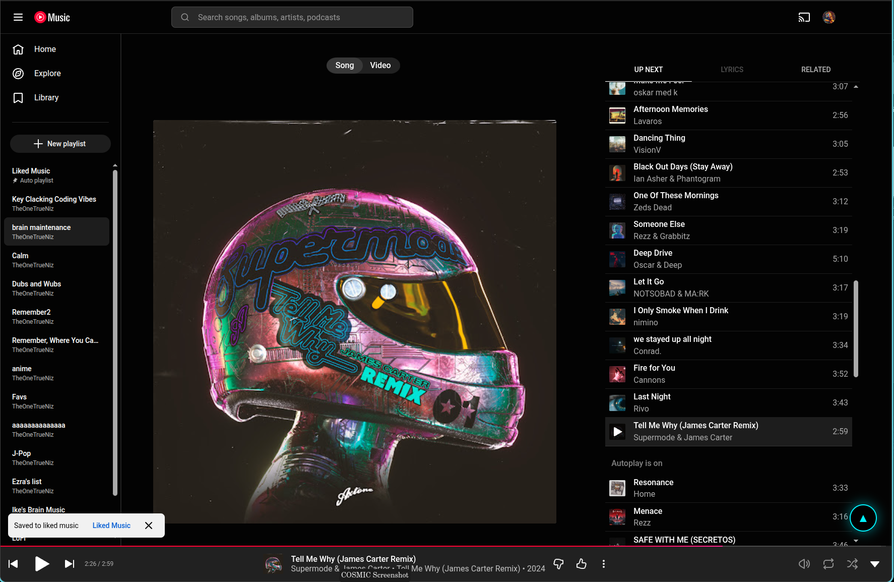

# AuDioPrism

**AuDioPrism** (or simply **Prism**) is a Chrome Extension designed to transform your YouTube Music experience into a neurodivergent-friendly, immersive auditory environment. It combines an 8D spatial audio processor with binaural beats, isochronic tones, and sensory-friendly audio processing to help with focus, relaxation, and sensory regulation.

> "Bad audio is a hate crime." — This extension is built with that philosophy. Every audio module is research-backed and carefully tuned for quality.

---

## Screenshots




## Features

### 8D Spatial Audio Engine

The core of Prism is a sophisticated HRTF (Head-Related Transfer Function) spatial audio engine that creates the immersive "8D audio" effect. Unlike simple left-right panning, HRTF processing simulates how sound reaches your ears from different positions in 3D space, accounting for the shape of your head and ears.

**Movement Patterns:**

| Pattern | Description | Best For |
|---------|-------------|----------|
| **Sine Orbit** | Classic circular movement around your head with subtle elevation changes | General listening, the signature "8D" experience |
| **Figure 8** | Lemniscate pattern that crosses in front of you | Bilateral stimulation, EMDR-like benefits |
| **Tumble** | Complex 3D spherical movement using three independent phases | Deep immersion, spatial exploration |
| **Drift** | Organic, pseudo-random wandering using layered sine waves | Ambient listening, reduced predictability |

**Controls:**
- **Speed** (0.01 - 5 Hz): How fast the sound moves around you
- **Depth** (0 - 1): How far from center the sound travels

### Binaural Beats

Binaural beats work by playing slightly different frequencies in each ear. Your brain perceives a "third tone" at the difference frequency, which can encourage brainwave entrainment.

**How It Works:**
- Left ear receives a carrier tone (e.g., 200 Hz)
- Right ear receives carrier + beat frequency (e.g., 210 Hz)
- Your brain perceives a 10 Hz "beat" (Alpha waves)

**Brainwave Frequencies:**

| Frequency | State | Effect |
|-----------|-------|--------|
| **40 Hz** (Gamma) | High cognition | Focus, memory, problem-solving |
| **14 Hz** (Beta) | Active thinking | Concentration, alertness |
| **10 Hz** (Alpha) | Relaxed focus | Calm attention, creativity |
| **6 Hz** (Theta) | Deep relaxation | Meditation, introspection |

**Technical Implementation:**
- Carrier frequency: 200 Hz (research-optimal for perception)
- Pure sine waves for clean beat perception
- Mixed at -22 dB below music (non-destructive)
- Requires headphones for the effect to work

### Isochronic Tones

Isochronic tones are rhythmic pulses of sound that turn on and off at precise intervals. Unlike binaural beats, they don't require headphones and produce stronger cortical responses in many people.

**How It Works:**
- A carrier tone (220 Hz) pulses on and off
- The pulse rate matches your target brainwave frequency
- Sharp transitions create stronger entrainment

**Controls:**
- **Frequency** (1 - 20 Hz): Pulse rate targeting specific brainwaves
- **Depth** (0 - 1): How complete the silence between pulses is
- **Waveform**: Sine (gentler) or Square (sharper entrainment)

**Technical Implementation:**
- Proper AM synthesis with DC offset for clean 0-to-1 pulses
- Mixed at -18 dB below music
- Works through speakers (no headphones required)

### Masking Noise Generator

Background noise can help mask distracting environmental sounds and provide a consistent auditory backdrop for focus.

**Noise Colors:**
- **Brown** (0): Deep, rumbling — like thunder or a waterfall
- **Pink** (0.5): Balanced — like steady rain
- **White** (1): Bright, hissy — like radio static

The Color knob smoothly sweeps between these by adjusting a lowpass filter from 80 Hz to 20 kHz.

### Stereo Field Processing

Adjust the stereo width of your music using Mid-Side processing.

- **Width** (0 - 2x): 0 = mono, 1 = normal, 2 = extra wide
- **Amount**: Cross-feed intensity for the width effect

### Dynamics Processing

**Compressor ("Dynamic Shield"):**
Protects your ears from sudden loud moments by automatically reducing volume spikes.

- **Threshold**: Level where compression begins (-50 to 0 dB)
- **Ratio**: How much to reduce signals above threshold (1:1 to 20:1)
- **Attack**: How quickly compression responds (0 - 100 ms)

### Harmonics (Saturation)

Adds subtle harmonic distortion for warmth and presence.

- **Drive**: Amount of saturation (0 - 100%)
- **Warmth**: Lowpass filter to tame harsh harmonics (dark to bright)

### Sensory EQ

A sweepable lowpass filter for sensory regulation. Useful for reducing harsh high frequencies that can cause discomfort.

- **Frequency** (200 Hz - 20 kHz): Filter cutoff point
- **Resonance** (0 - 10): Emphasis at the cutoff frequency

### Master Console

- **Music Volume**: Main music level (0 - 150%)
- **FX Volume**: Binaural/Isochronic/Noise level (0 - 150%)
- **3-Band EQ**: Low shelf (250 Hz), Mid peak (1 kHz), High shelf (4 kHz)

---

## The Science: Neurodivergent-Friendly Audio

### Why 8D Audio Helps

For people with ADHD, autism, or sensory processing differences:

1. **Reduced Ear Fatigue**: Static stereo can become fatiguing. Movement keeps the listening experience fresh.
2. **Increased Engagement**: The spatial movement provides subtle stimulation that can help maintain focus.
3. **Bilateral Stimulation**: The Figure-8 pattern mimics bilateral stimulation used in EMDR therapy.

### Why Binaural Beats Help

Research suggests binaural beats may:
- Reduce anxiety (Alpha/Theta frequencies)
- Improve focus and attention (Beta/Gamma frequencies)
- Support meditation practices (Theta frequencies)

*Note: Effects vary between individuals. Binaural beats are a tool, not a treatment.*

### Why Isochronic Tones Help

For neurodivergent users, isochronic tones can:
- Provide external rhythmic scaffolding for the brain
- Help maintain task engagement through steady sensory input
- Work without headphones (important for sensory sensitivities)

### Non-Destructive Mixing Philosophy

All supplementary audio (binaural, isochronic, noise) is mixed **beneath** the music at carefully calibrated levels:

| Source | Level | Reason |
|--------|-------|--------|
| Binaural Beats | -22 dB | Subliminal but effective |
| Isochronic Tones | -18 dB | Audible pulse, not overpowering |
| Masking Noise | -26 dB | Background texture only |

This ensures the music remains the primary experience while the therapeutic tones work subtly alongside it.

---

## Installation

This extension is built for **Google Chrome** (Manifest V3).

1. **Clone or Download** this repository to your local machine.
2. Open Chrome and navigate to `chrome://extensions/`.
3. Enable **Developer mode** (toggle in the top right corner).
4. Click **Load unpacked**.
5. Select the `prism_extension` folder (containing `manifest.json`).

## How to Use

1. Open [music.youtube.com](https://music.youtube.com) and start playing a track.
2. Click the **AuDioPrism icon** in your Chrome toolbar.
3. Click **"Launch Prism"** in the popup.
4. A floating trigger button (▲) appears at the bottom right. Click to open the control panel.
5. **Use headphones** for binaural beats and optimal 8D audio effect.

### Quick Start Recommendations

**For Focus (ADHD):**
- 8D: Sine Orbit, Speed 0.15 Hz, Depth 0.8
- Binaural: 40 Hz Gamma or 14 Hz Beta
- Dynamics: ON (Threshold -20 dB)

**For Relaxation:**
- 8D: Drift, Speed 0.08 Hz, Depth 0.6
- Binaural: 10 Hz Alpha or 6 Hz Theta
- Masking: Brown noise at low level

**For Sensory Overload:**
- Sensory EQ: Reduce Freq to 8-12 kHz
- Dynamics: ON (aggressive settings)
- 8D: OFF or very slow

---

## Technical Architecture

### Audio Signal Flow

```
YouTube Music Audio
        │
        ▼
   [Music Gain] ──► [Stereo Widener] ──► [3-Band EQ]
        │                                      │
        │                                      ▼
        │                              [Sensory Filter]
        │                                      │
        │                                      ▼
        │                              [Saturation]
        │                                      │
        │                                      ▼
        │                              [Compressor]
        │                                      │
        │                                      ▼
        │                              [8D Spatial Panner]
        │                                      │
        ▼                                      ▼
   [FX Gain] ◄── Binaural ──────────────► [Master Gain]
        │       Isochronic                     │
        │       Noise                          ▼
        │                                 [Limiter]
        │                                      │
        └──────────────────────────────────────┘
                                               │
                                               ▼
                                          [Output]
```

### Key Technologies

- **Web Audio API**: All processing uses native browser audio nodes
- **HRTF Panning**: Built-in Chrome HRTF for 3D spatialization
- **Offscreen Document**: Audio processing runs in isolated context for stability
- **Shadow DOM**: UI is encapsulated to avoid conflicts with YouTube Music

### Permissions

| Permission | Purpose |
|------------|---------|
| `tabCapture` | Capture audio from YouTube Music tab |
| `offscreen` | Run audio engine in background document |
| `scripting` | Inject control panel UI |
| `music.youtube.com` | Restrict to YouTube Music only |

---

## Project Structure

```
prism_extension/
├── manifest.json        # Extension configuration (MV3)
├── background.js        # Service worker, lifecycle management
├── offscreen.html       # Audio processing document container
├── audio-engine.js      # Core DSP: 8D, binaural, isochronic, etc.
├── content.js           # UI injection, controls, styling
├── popup.html/.js       # Extension popup (launch button)
├── icons/               # Extension icons
└── screenshots/         # UI screenshots for documentation
```

---

## References & Research

- [MDN Web Audio API Spatialization](https://developer.mozilla.org/en-US/docs/Web/API/Web_Audio_API/Web_audio_spatialization_basics)
- [Oster, G. (1973). Auditory beats in the brain. Scientific American](https://www.scientificamerican.com/article/auditory-beats-in-the-brain/)
- [PMC: Effects of Binaural Beat Stimulation on Cognitive Functioning](https://pmc.ncbi.nlm.nih.gov/articles/PMC7204407/)
- [Audioengine: ADHD and Binaural/Isochronic Comparison](https://audioengine.com/explore/adhd-and-music-how-binaural-beats-and-isochronic-tones-compare-for-better-focus/)
- [Google Omnitone: Spatial Audio Rendering](https://github.com/GoogleChrome/omnitone)

---

## License

This project is licensed under the **GNU General Public License v3.0** - see the [LICENSE](LICENSE) file for details.

You are free to use, modify, and distribute this software under the terms of the GPL-3.0. If you distribute modified versions, they must also be open-sourced under GPL-3.0.

---

*Built with care for neurodivergent listeners.*
